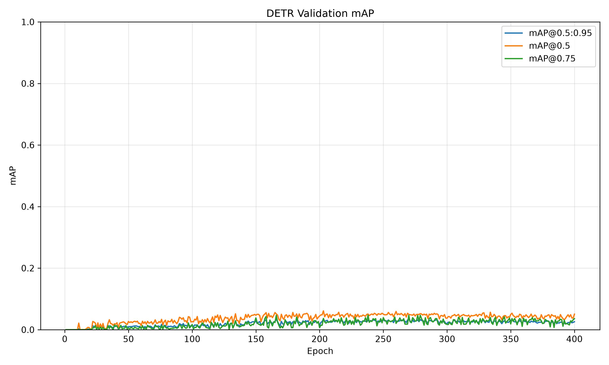

# DETR

用 PyTorch 手写 DETR，练习从图片特征、object query 到目标检测的完整流程。模型用预训练的 ResNet-50 提取特征，手写多头注意力和 Transformer Encoder / Decoder。训练时用匈牙利算法把预测和 GT 一对一匹配，再算分类、L1 和 GIoU 损失。 [DETR 论文](https://arxiv.org/abs/2005.12872)

## COCO128 实验

这次用 COCO128 做小规模训练，主要想跑通数据读取、训练和 mAP 验证。训练和验证按约 8:2 划分，训练 400 轮，每轮用 TorchMetrics 计算验证指标。最佳轮按 mAP@0.50:0.95 选取，表中三项指标来自同一轮。

| 轮次 | mAP@0.50:0.95 | AP50 | AP75 |
| --- | ---: | ---: | ---: |
| 第 203 轮（最佳） | **3.48%** | **6.11%** | **3.66%** |
| 第 400 轮 | 2.59% | 5.04% | 3.58% |

完整记录见 [history.json](history.json)。



## 运行

准备 COCO128 的 `images/train2017` 和 `labels/train2017`，把 [moxie.py](moxie.py) 主程序里 `MyDataset(...)` 的路径改成自己的数据目录。当前配置使用 640×640 输入、40 个 query、冻结 ResNet-50、batch size 6 和 Adam（学习率 `1e-4`）。

```bash
python -m pip install torch torchvision scipy pillow "torchmetrics[detection]"
python moxie.py
```

运行时生成 `history.json`、最佳权重 `bestDetr.pt` 和最后一轮权重 `lastDetr.pt`。
